 

<!-- Animated Typing Sub-banner -->

<!-- Social & Contact Badges -->

  
  
  
  

---

### 👋 About Me

I'm a **Senior Software Engineer, Team Lead, and AI Researcher** based in **Toronto, Canada**, with **7+ years of experience** spanning machine learning, production backend engineering, and peer-reviewed AI research.

- 🔭 **Currently** leading delivery of **Software Engineering (SWE) benchmarks** and architecting **multi-agent AI systems** at **Turing** (*Turing Google Hero of the Month* recipient)
- 🧠 **Focus Areas:** AI evaluation & benchmarking, agentic architectures, tool orchestration, cross-agent coordination, real-time anomaly detection & sequential forecasting
- 🦀 **Open-Source Passion:** Crafting lightweight, zero-daemon **Rust TUIs** for macOS (`MacFanControl`, `mtype`, `audio_stats`) and on-device **Swift / CoreML** apps
- 🎓 **Education:** **MASc** — *University of Victoria (2021)* · **BSc** — *Iran University of Science and Technology (2018)*

---

### 🛠️ Tech Stack & Tooling

**Languages**

  

**AI, Machine Learning & Agentic Systems**

  
  
  
  
  

**Backend, Streaming Data & Cloud Infrastructure**

  
  
  

---

### 🚀 Featured Open-Source Projects

  
  
   
  
  

 

### 🧩 Selected AI & Production Systems

| System | Year | Highlights & Stack |
| :--- | :---: | :--- |
| 🤖 **Agentic AI Playground** | `2025` | Modular multi-agent architectures featuring vector search, observability, and dynamic tool orchestration using **LangChain**, **CrewAI**, and **Dify**. |
| ⚡ **LangChain & CrewAI Pipelines** | `2025` | Reusable automated workflows for large-scale code refactoring, repository organization, and documentation synthesis. |
| 📡 **Real-Time IoT Telemetry Dashboard** | `2023` | High-frequency sensor ingestion, live time-series visualization, anomaly alerts, and predictive analytics powered by **AWS**, **Kafka**, and **React**. |

---

### 💼 Experience Highlights

| Role & Organization | Period | Key Impact |
| :--- | :---: | :--- |
| **Senior Software Engineer / Team Lead** · **Turing** | `Jan 2025 – Present` | Leading SWE benchmark delivery & technical coordination; architected multi-agent AI systems, FastAPI/Celery/PostgreSQL analytics backends, anomaly detection pipelines, and React/Next.js live telemetry dashboards. 🏆 *Turing Google Hero of the Month* |
| **Machine Learning Engineer** · **Hummingbird Drones** | `Jan – Aug 2023` | Built AWS/GCP IoT pipelines for high-frequency sensor streams; developed sequential forecasting & anomaly detection models optimized for near-real-time inference. |
| **Data Scientist** · **Kinsol Research** | `Nov 2021 – Dec 2022` | Developed YOLOv7 object detection workflows with automated annotation and integrated Hidden Markov Models (HMMs) for sequential data analysis. |
| **Technical Analyst** · **4M Biotech** | `Sep 2020 – Oct 2021` | Built iOS applications with on-device ML inference using **Swift** and **CoreML**, including the *Gelderm* medical-image classifier. |
| **Research Assistant** · **University of Victoria** | `Apr 2019 – Nov 2021` | Researched capsule networks for image classification & detection; developed pruning methods to lower computational cost. |

---

### 📚 Selected Research Publications

-  **Pruning in Capsule Networks: A Survey** — *R. Sharifi, P. Shiri, & A. Baniasadi*
-  **Quick-CapsNet (QCN): A Fast Alternative to Capsule Networks** — *P. Shiri, R. Sharifi, & A. Baniasadi*
-  **Zero-skipping in CapsNet: Is it Worth It?** — *R. Sharifi, P. Shiri, & A. Baniasadi*
-  **Mobile User-Activity Prediction Utilizing LSTM Recurrent Neural Network** — *R. Sharifi, M. M. Majdabadi, & V. Tabataba Vakili*

---

### 📊 GitHub Analytics & Activity

  

  

 

  

